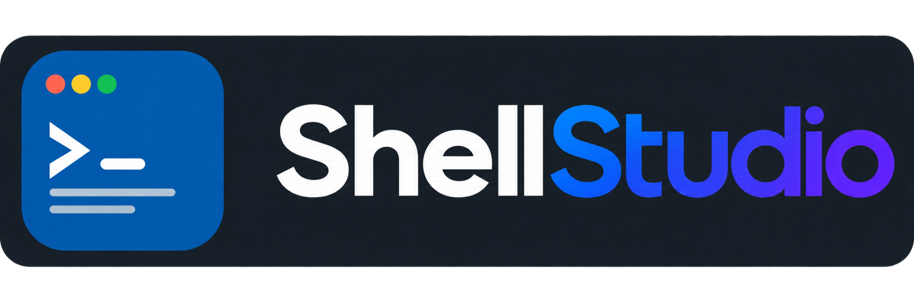

<div align="center">

</div>

Shell Studio is a standalone Linux terminal workspace for local terminals, WSL,
SSH and Mosh.
Persistent consoles live in a private tmux server. The workspace opens directly
into a view, with a file tree on the left, console headers and clickable dialogs,
following the layout and interaction of sesiones. Notes and extension management
use dedicated Bubble Tea screens.

License: GPL-3.0-only. Bundled agent-chat and agent-gantt packages retain MIT.
External programs have their own licenses. No agent installation is required.

## What's new

- A top bar lists your views as tabs; click one to switch. Its New console,
  Arrange and More menus open under the pointer.
- Console headers read "Kind · Name" and have ─ (minimize), □ (maximize) and ▼
  (menu) buttons. The focused console is highlighted in blue.
- Minimized consoles keep running and appear in the Minimized panel under the
  file tree. You can search them, filter by tag, sort the columns and restore a
  console to its original place with a double click.
- Tags: create, rename, recolor, reorder and delete your own colored tags, then
  give each console a tag and a short description.
- The file tree has a search field that filters the tree and keeps the folders
  that contain matches.
- The interface is available in Spanish and English: it follows your locale, or
  choose a language under More ▸ Language.
- The width of the left column and the height of the Minimized panel are saved
  per view.
- The maximize button shows ❐ while its panel is zoomed. Tags also move with
  Shift+↑/↓.
- Terminal replies that arrive split or late (common over SSH and with Windows
  Terminal) no longer move consoles or type digits into them. Moving a console
  before or after its neighbor is now Alt+< / Alt+>.

## Install

On Linux or WSL2 (amd64/arm64):

```sh
curl -fsSL https://raw.githubusercontent.com/TobiasCoding/ShellStudio/main/scripts/install.sh | sh
```

The installer downloads the latest stable GitHub Release, verifies its SHA-256
checksum and version, and installs `shellstudio` in `~/.local/bin`. It sets up
PATH for Bash, Zsh, Fish and POSIX login shells. Open a new terminal if that
directory was not already in PATH, or run `export PATH="$HOME/.local/bin:$PATH"`
in the current Bash/Zsh shell. You can then run `shellstudio` from any directory.

Requirements: curl, standard Linux tools (including sha256sum and flock), and
tmux 3.4+. If tmux is missing, the installer asks before using the system package
manager; this step may require sudo. No Go installation is needed. Optional MCP
installation needs Python 3.9+ with venv/ensurepip.

To review the script or select a version first:

```sh
curl -fsSL https://raw.githubusercontent.com/TobiasCoding/ShellStudio/main/scripts/install.sh -o install.sh
less install.sh
sh install.sh --version v0.2.2
```

Options include `--bin-dir /absolute/directory`, `--no-path`, and `--yes` to permit
installing a missing tmux without the confirmation prompt. A custom binary
directory must already be on PATH or be added by you. Re-running the installer
replaces the executable and preserves workspace data.

## Remote connections with Mosh (highly recommended)

We strongly recommend [Mosh](https://mosh.org/) for remote ShellStudio sessions,
especially over Wi-Fi or unstable connections. It reconnects after temporary
network interruptions and network changes, and makes typing feel more responsive.

**Install Mosh on both your local computer and the remote Linux server.** On
Windows, you can use it from a Linux distribution such as Ubuntu inside
[Windows Subsystem for Linux (WSL)](https://learn.microsoft.com/en-us/windows/wsl/install).
Run the local installation commands inside that distribution, then connect to
the server over SSH and install Mosh there too. ShellStudio must also be installed
on the server.

On Ubuntu or Debian, run on **each end**:

```sh
sudo apt update
sudo apt install mosh
```

For other Linux distributions, use the corresponding command on each machine:

| Distribution | Install Mosh |
| --- | --- |
| Fedora | `sudo dnf install mosh` |
| Arch Linux | `sudo pacman -Syu mosh` |
| openSUSE | `sudo zypper install mosh` |

Use Mosh 1.4 or newer on both ends. SSH access must work for login, and the server
firewall or cloud security group must allow incoming UDP ports 60000–61000 for
the Mosh connection.

From your local Linux or WSL terminal:

```sh
mosh user@server
# Once connected to the server:
shellstudio /path/to/project
```

Clipboard copying still requires support and permission in your local terminal.
File transfers and port forwarding use SSH.

## Open a folder

```sh
cd /path/to/project
shellstudio                  # Open the current directory
shellstudio .                # The same, explicitly
shellstudio /path/to/project # Open another directory
shellstudio "folder with spaces"
shellstudio --menu           # Resume the last view (F7 opens saved views)
```

ShellStudio reuses a saved view for the folder, or creates one. Existing consoles
keep their working directories; stopped programs are not restarted automatically.
Use `shellstudio open DIRECTORY` or `shellstudio ./notes` when a folder name
matches a command such as `notes` or `update`.

## Updates

Each interactive workspace or Notes launch checks GitHub for a newer stable
release before opening the UI. When one is available, ShellStudio asks
`Install now? [y/N]`. Only an explicit yes installs it. Declining continues with
the current version; the next launch checks again. The check has a two-second
deadline and offline or rate-limited checks do not prevent startup.

```sh
shellstudio update --check   # Report availability without installing
shellstudio update           # Check and ask before installing
SHELLSTUDIO_NO_UPDATE_CHECK=1 shellstudio # Skip the startup check
```

Updates verify checksums and the executable's version, then atomically replace
the binary. Failed downloads leave the installed executable intact. After a
startup update, ShellStudio reopens with the same arguments and current directory.
Existing consoles keep running. Noninteractive commands and internal tmux helpers
do not check for updates. No extension or agent is updated by this mechanism.

## Workspace

The file tree occupies the left side at full height. Its clickable shortcuts open
the same dialogs as the keyboard:

| Key | Action |
| --- | --- |
| F2 | View menu: consoles, layouts, views, explorer, ports and agent permissions |
| F3 | Create a console; choose its kind and editable name |
| F5 | Arrange all consoles, or create a view from a marked subset |
| F7 | Browse, create or delete saved views |
| F9 | Confirm ending the selected console |
| F10 | Leave; programs keep running |
| F4 | Zoom or restore the selected panel |
| F6 / Shift+F6 | Next / previous panel |
| Ctrl+Alt+arrows | Focus a panel in that direction |
| Ctrl+Shift+Left/Right or F8 / Shift+F8 | Change view |
| Alt+1–5 | Columns, rows, grid, active on the left, active on top |
| Alt+< / Alt+> | Move the console before / after its neighbor |

The top bar shows one tab per view; right-click a tab to rename or close the
view. New console ▼, Arrange ▼ and More ▼ hold the same actions as F2 plus tags,
the Minimized panel and the language.

Click or right-click a console header to rename, zoom, move, replace, close its
panel or end its program. Its ─ button minimizes the console: the program keeps
running and the console moves to the Minimized panel under the tree, where
Enter or a double click restores it to its place. □ zooms the panel and ▼ opens
its menu, which also sets the console's tag and description. Drag a header onto another console to exchange their
positions. Drag borders to resize with live feedback. Drag a file from
the tree onto a console to type its path. The tree supports search (/), previews,
editing with nano (E), renaming (N) and reload (R). Its expanded folders and
selection are saved per view. F2 can restore a hidden explorer.

Dialogs accept keyboard navigation and mouse clicks; Escape cancels. Closing a
panel preserves its program; killing a console requires confirmation. Finished
and disconnected consoles show options to restart, reconnect or close the panel.
Closing the UI or SSH connection preserves programs. After a machine restart,
programs are stopped and must be explicitly restarted.

There is one presentation session per view. Two clients looking at the same view
share focus, layout and pane size. Different views have separate focus; a console
can appear in several views without starting its program again.

## Notes

Choose Notes in F3 or run `shellstudio notes`; n creates a note.
Search with /, trash with d, toggle trash with t,
rename/restore with r, and export Markdown with e. The library is global.

Saving starts after 300 ms idle or at least once per second while typing.
Saved means SQLite has committed and synced the transaction. Slow storage can
extend Saving. Escape flushes before leaving. Write failures keep the editor
and its text, show the actual error, and allow retry with Ctrl+S or another edit.
Concurrent revisions create a conflict copy. Abrupt kills may lose pending edits.

## Extensions

Run `shellstudio extensions manage` to open the extension manager.
Terminal is the only built-in program launcher. Notes is bundled and enabled.
Claude, Codex, agent-chat and agent-gantt are optional. Their catalog is always
available, even if the programs are absent.

- Enter: origin, version, dependencies and installation details.
- i: preview/install; e: enable detected program; d: disable.
- c: configure a default named profile with executable, JSON arguments and env.
- a: import a manifest from a file or HTTPS URL; n: add an existing command.
- u: uninstall and retain data; uppercase X: also request data deletion.
- m: preview MCP registration for Claude/Codex, with backup and conflict checks.
  Missing clients produce pending registration; return to m after installation.

Installation is per-user, version pinned, integrity checked and verified before
activation. No automatic extension updates. Disabling does not
stop programs. Uninstall retains immutable packages for active consoles; see
[storage](docs/storage.md) for reclamation. The MCPs install offline into separate
Python venvs and include read-only viewers. No private sessions or data migrate.

## Diagnostics

    shellstudio doctor
    shellstudio report
    shellstudio backup /absolute/path/backup.db
    shellstudio validate examples/htop.json

`shellstudio report` exports a private JSON diagnostic file with recent automatic
logs and the current workspace state. Reproduce the issue and send the file it
prints; see [diagnostic reports](docs/diagnostics.md) for contents and limits.

## Agent permissions

F2 → W (Agent permissions) is a global setting: it chooses the permission mode
that new Claude and Codex consoles start with, in every view. It is stored as
`agent_permissions` in `config.json`. Equivalent command line:

    shellstudio permissions                  # list modes and the current choice
    shellstudio permissions claude acceptEdits
    shellstudio permissions codex workspace-write

| Agent | Modes (flags added at launch) |
| --- | --- |
| Claude | `default` (none), `plan`, `acceptEdits`, `auto`, `dontAsk`, `bypassPermissions` (`--permission-mode MODE`) |
| Codex | `default` (none), `read-only`, `workspace-write` (`--sandbox … --ask-for-approval on-request`), `workspace-never-ask` (`--ask-for-approval never`), `full-access` (`--dangerously-bypass-approvals-and-sandbox`) |

`default` adds nothing, so the agent's own configuration decides; it is the
initial value. Modes without approvals (`bypassPermissions`, `full-access`) ask
for confirmation in the dialog. The setting applies to consoles created or
replaced afterwards; running consoles and restarts keep their original
arguments. A profile configured with its own permission flags (extension
manager → c) keeps them. An unknown stored mode blocks the launch with an error.

F2 → Forward ports opens the SSH forwarding dialog. Dropping a Windows path in
the explorer opens an SCP upload dialog. OSC 52 clipboard copying needs support
and permission in the local terminal. Ctrl+B then [ enters tmux copy mode.

See [architecture](docs/architecture.md), [extensions](docs/extensions.md),
[storage/recovery](docs/storage.md), [security](SECURITY.md),
[contributing](CONTRIBUTING.md), [releasing](docs/releasing.md) and
[notices](THIRD_PARTY_NOTICES.md).
